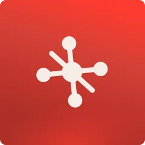
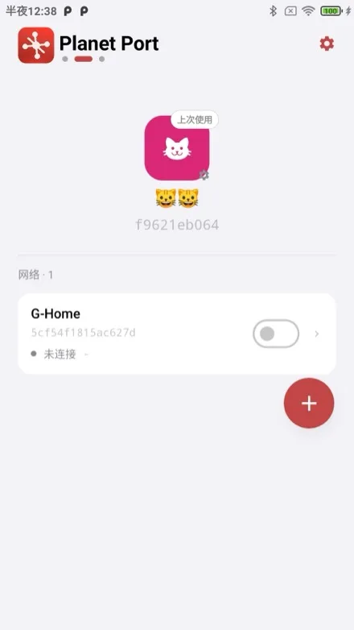
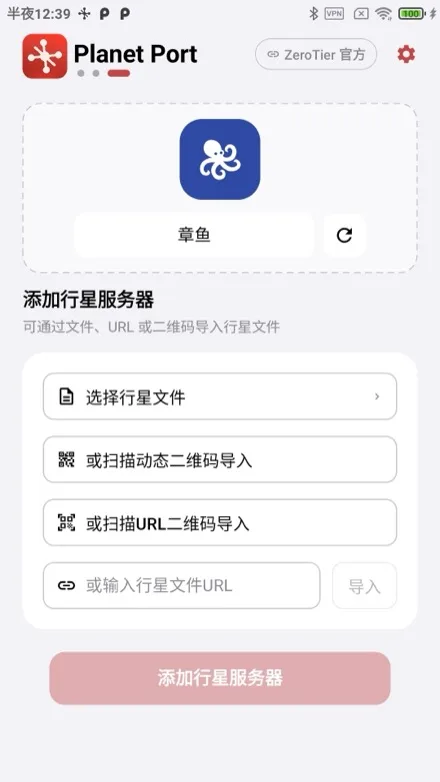
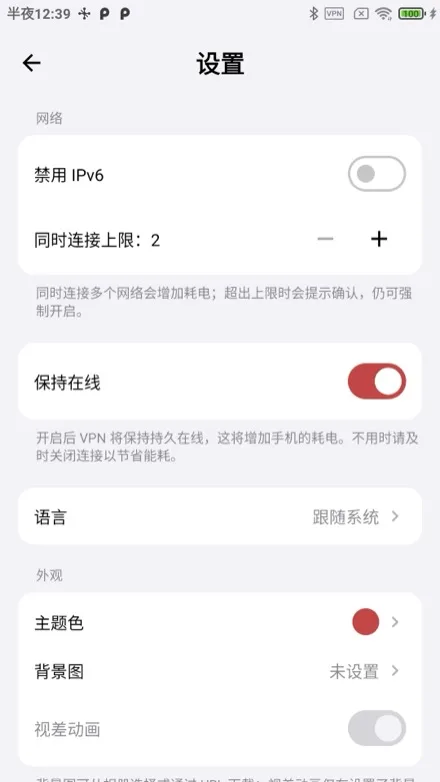
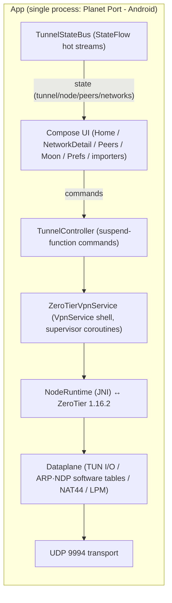

<p align="center">
  
</p>

# Planet Port - Android 🪐

[简体中文](README.md) | [繁體中文](README.zh-Hant.md) | English

**Planet Port - Android** is an open-source Android ZeroTier client built on the official ZeroTier 1.16 core. It makes mesh networking and virtual LAN management on your phone effortless: multiple Planets side by side (official + self-hosted private Planets), several networks connected at once, full control over default routing and DNS. Native Jetpack Compose, free and open source — an advanced alternative to the official ZeroTier One app.

> Unofficial client. Not affiliated with ZeroTier, Inc.

## Highlights

- **Multi-Planet management** — keep the official and multiple private Planets side by side; import via file/URL or QR code
- **Multi-network connectivity** — soft limit (default 2, adjustable 2–6) with explicit confirmation; address/subnet conflicts are detected automatically and disconnected
- **Full network management** — join/leave networks with live status, one-tap managed-IP copy
- **Default route & DNS modes** — route-through-ZT toggle and three DNS modes (network-provided / custom / none), all hot-reconfigured inside the tunnel, no reconnect needed
- **Moon nodes** — .moon file import, manual orbit, cache management
- **Keep online** — auto-reconnect on network change; fine-grained cellular and IPv6 controls
- **Theming** — classical Chinese painting color presets plus a custom color picker; the whole visual system (including planet decorations and status colors) derives from your main color
- **Native Jetpack Compose**, switchable between Simplified Chinese / Traditional Chinese / English, zero telemetry

## Screenshots

<p align="center">
  
  
  
</p>

## Getting Started

> **Requirements**: Android 6.0 (API 23) or later. Building requires JDK 21 and NDK 25.2.9519653 (both installable from Android Studio).

```bash
./scripts/bootstrap.sh
./gradlew assembleDebug
adb install app/build/outputs/apk/debug/app-debug.apk
```

`bootstrap.sh` fetches the ZeroTier core sources from the official repo by pinned tag (SHA256-verified) into `externals/core/` (gitignored, never committed), cached in `~/Library/Caches/PlanetPort/` so re-runs are instant. If the download fails:

```bash
# Use a mirror
ZT_TARBALL_URL=<mirror-url> ./scripts/bootstrap.sh
# Or download the tarball in a browser, drop it in the cache dir and re-run (offline use once verified)
mkdir -p ~/Library/Caches/PlanetPort
cp ZeroTierOne-1.16.2.tar.gz ~/Library/Caches/PlanetPort/
```

To upgrade the ZeroTier version: change `ZT_VERSION` and `ZT_SHA256` in `scripts/bootstrap.sh` and re-run.

## Basic Usage

1. **Install**: build the APK as shown above, or open the project in Android Studio and hit Run. No signing hurdles.
2. **Join a network**: add a Planet on the home page (or use the official one) → enter the 16-digit network ID → authorize the new node at [ZeroTier Central](https://my.zerotier.com) → the status turns "online" and you're connected.
3. **Switch Planets**: import a private Planet file/URL → swipe between planets on the home page → flip on one of its networks to switch the tunnel.
4. **Keep online**: enable "Keep online" in Settings; connections survive network changes.

## Architecture



- **Core**: ZeroTier 1.16.2 runs in-process via JNI (no separate tunnel process); core state is persisted under per-Planet directories
- **IPC**: the UI issues commands through TunnelController suspend functions; components report state back via TunnelStateBus StateFlows — **no Binder, no AIDL, no event bus**
- **Multi-network dataplane**: a single TUN carries multiple networks; Dataplane isolates MAC/addresses/ARP/NDP routes per network, NAT44 rewrites multi-network source addresses, LPM picks networks and detects subnet conflicts
- **Frame semantics**: C API frames carry no Ethernet header (MAC/etherType are separate parameters); Dataplane converts them to/from L3 IP packets for the TUN, with ARP/NDP as pure software tables

### Project layout

- `externals/core/` — ZeroTier 1.16.2 core sources (fetched by `scripts/bootstrap.sh` from the official tag at build time, never committed)
- `externals/CMakeLists.txt` — NDK build script (out-of-tree GLOB build glue)
- `core/jni/` — JNI binding layer (C API ↔ Kotlin)
- `app/` — the app itself (`ui/` Compose UI, `tunnel/` tunnel & dataplane, `store/` config storage)

## Acknowledgements

- [ZeroTier](https://github.com/zerotier/ZeroTierOne) — networking core
- Some animal icons from [Material Design Icons](https://pictogrammers.com/) (Pictogrammers Free License) and [Font Awesome Free](https://fontawesome.com/) (CC BY 4.0, Icons by Font Awesome).

## Donate

If Planet Port - Android helps you, buy the author a coffee ☕

**BTC** (Taproot)

```
bc1p5426677uuazuvfy9fptmczv4zwv550qlu9umw9jyptw5q7ln420qe03ae6
```

**ETH** (Ethereum)

```
0xbaa7a263a95bddb2ff364d1c47e385ed9f54a66a
```

**SOL** (Solana)

```
CFjZhq1dYdQCFKgkhbBwQEzg21WKwoNAm9KZ9uk2nJyf
```
