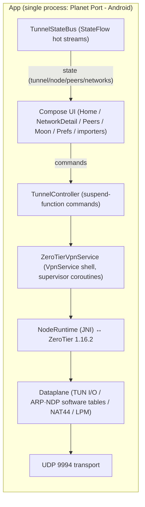

<p align="center">
  
</p>

# Planet Port - Android 🪐

[简体中文](README.md) | [繁體中文](README.zh-Hant.md) | English

**Planet Port - Android** is an open-source Android ZeroTier client, built on the official ZeroTier 1.16.2 core and written in native Jetpack Compose. It manages Planets and networks on your phone: multiple Planets side by side, several networks connected at once, with full control over the default route and DNS.

Planets import via file, URL or QR code, and share via file or QR code. The official Planet and self-hosted private Planets share the same home page — swipe to switch, and the tunnel follows instantly.

Free and open source, zero telemetry — an advanced alternative to the official ZeroTier One app.

> Unofficial client. Not affiliated with ZeroTier, Inc.

## Origin

I've been running my own private network on ZeroTier for almost three years. What impressed me most is "configure once, use invisibly" — it never gets in your way, yet it's everywhere, letting you reach your home devices from anywhere.

Android already had ZerotierFix for custom Planets, but Planet import and sharing, multi-network connectivity, and fine-grained routing/DNS control always fell a bit short. So the full Planet Port experience from the iOS version was brought to Android — that's Planet Port - Android.

## Features

### Planet management

- **Multiple Planets side by side** — manage the official Planet together with multiple private ones; the tunnel applies exactly one at a time
- **Import** — Planet file, file URL, or QR code. QR transfer uses dynamic chunking with adaptive capacity, so even large files go through; scanning supports live camera and photo-library recognition
- **Share** — file (via the system share sheet) or QR code; device-to-device transfer in seconds
- **A Planet is a world** — core state is persisted under per-Planet directories; switching Planets never mixes data
- **Cross-Planet switching** — confirm the disconnect first, then start the new tunnel, through a confirmation dialog that stays under your control
- **Duplicate protection** — deduplicated by World ID; the same Planet can't be added twice
- **Moon nodes** — .moon file import, manual orbit, cache management

### Network connectivity

- **Multi-network** — a single tunnel carries multiple networks; the soft limit defaults to 2 and is adjustable from 2–6, with explicit confirmation required beyond it
- **Automatic conflict disconnect** — address or subnet conflicts are detected and disconnected automatically, with the reason shown right on the network card
- **Toggle to connect** — the toggle on each network row applies the tunnel config directly; states are visible in real time
- **Fine-grained status** — initializing → connecting → online, each stage clearly labeled; on connect timeout the core restarts silently and retries indefinitely (until online or manually turned off); "no network" shows instantly on connectivity loss, with automatic reconnection across network switches
- **Join networks** — enter a 16-digit network ID or scan a QR code; authorize the new node at [ZeroTier Central](https://my.zerotier.com) and you're connected
- **One-tap copy** — managed IPs, node ID and network ID copy on tap; the network ID is also available as a QR code

### Routing & DNS

- **Default route** — a single "route through ZeroTier" toggle sends all traffic through the tunnel
- **Three DNS modes** — network-provided / custom / none
- **Hot reconfiguration** — every routing or DNS change happens inside the tunnel; no disconnect and reconnect needed
- **IPv6** — can be disabled on demand

### Peers

- **Live peer list** — latency shown in semantic colors (<30ms green / <100ms orange / ≥100ms red), marked "relay" when no direct path exists

### Experience

- **Stay connected** — connections auto-restore on network changes (Wi-Fi/cellular switches)
- **Theming** — classical Chinese painting color presets plus an HSL wheel for any main color; planet decorations and status colors derive from it globally
- **Background parallax** — custom background image (from gallery or URL) with a gravity-sensor-driven parallax animation; can be turned off
- **Localization** — Simplified Chinese, Traditional Chinese and English
- **Data-plane diagnostics** — in/out traffic, ARP question/answer counts, no-route drops and an event log for troubleshooting
- **Zero telemetry** — no data collection whatsoever


## Getting Started

1. **Join a network**: add or pick a Planet on the home page (the official one works out of the box) → "Add Network" with a 16-digit ID or a QR scan → authorize the new node at ZeroTier Central → the status turns "online" and you're connected.
2. **Switch Planets**: import a private Planet (file / URL / QR code) → swipe on the home page → flip on a network under it; the tunnel switches to the new Planet right away.
3. **Stay connected**: enable "Stay Connected" in Settings; connections survive network changes.

## Screenshots

<p align="center">
  
  
  
</p>

## Build from Source

> **Requirements**: Android 6.0 (API 23) or later. Building requires JDK 21 and NDK 25.2.9519653 (both installable from Android Studio).

```bash
./scripts/bootstrap.sh
./gradlew assembleDebug
adb install app/build/outputs/apk/debug/app-debug.apk
```

Or open the project in Android Studio and hit Run. No signing hurdles.

`bootstrap.sh` fetches the ZeroTier core sources and prepares the build: the core sources are downloaded from a pinned tag (SHA256-verified) into `externals/core/` (gitignored, never committed) and cached under `~/Library/Caches/PlanetPort/` — reruns are instant.

If the download fails, there are two ways out:

```bash
# use a mirror
ZT_TARBALL_URL=<mirror-url> ./scripts/bootstrap.sh

# or drop the tarball into the cache directory and rerun (works offline once verified)
mkdir -p ~/Library/Caches/PlanetPort
cp ZeroTierOne-1.16.2.tar.gz ~/Library/Caches/PlanetPort/
```

To upgrade the ZeroTier version: update `ZT_VERSION` and `ZT_SHA256` in `scripts/bootstrap.sh` and rerun.

## Architecture



- **Process model** — ZeroTier 1.16.2 runs in-process via JNI (no separate tunnel process); core state is persisted under per-Planet directories
- **IPC** — the UI issues commands through TunnelController suspend functions; components report state back via TunnelStateBus StateFlows — **no Binder, no AIDL, no event bus**
- **Multi-network data plane** — a single TUN carries multiple networks; Dataplane isolates MAC / addresses / ARP / NDP / routes per network; multi-network source addresses are rewritten by NAT44 in the data plane; LPM picks networks and detects subnet conflicts
- **Frame semantics** — C API frames carry no Ethernet header (MAC and etherType are separate parameters); Dataplane converts them to/from L3 IP packets for the TUN, with ARP/NDP as pure software tables

### Project layout

- `externals/core/` — ZeroTier 1.16.2 core sources (fetched by `scripts/bootstrap.sh` from the official tag at build time, never committed)
- `externals/CMakeLists.txt` — NDK build script (out-of-tree GLOB build glue)
- `core/jni/` — JNI binding layer (C API ↔ Kotlin)
- `app/` — the app itself (`ui/` Compose UI, `tunnel/` tunnel & dataplane, `store/` config storage)

### Further reading

- [CHANGELOG.md](CHANGELOG.md) — release notes

## Acknowledgements & Licenses

- [ZeroTier](https://github.com/zerotier/ZeroTierOne) — the network core, MPL-2.0; license text at [docs/licenses/ZeroTierOne-MPL-2.0.txt](docs/licenses/ZeroTierOne-MPL-2.0.txt). nlohmann/json and prometheus-cpp-lite ship with the core under MIT — see `docs/licenses/`
- The app itself is [MIT](LICENSE) licensed
- Some animal icons are from [Material Design Icons](https://pictogrammers.com/) (Pictogrammers Free License), [Font Awesome Free](https://fontawesome.com/) (CC BY 4.0; Icons by Font Awesome) and [game-icons](https://game-icons.info/) (Lorc, Delapouite and other authors, CC BY 3.0); all icon assets have been recolored and re-encoded

## Donate

If Planet Port - Android helps you, consider buying the author a coffee ☕

**BTC** (Taproot)

```
bc1p5426677uuazuvfy9fptmczv4zwv550qlu9umw9jyptw5q7ln420qe03ae6
```

**ETH** (Ethereum)

```
0xbaa7a263a95bddb2ff364d1c47e385ed9f54a66a
```

**SOL** (Solana)

```
CFjZhq1dYdQCFKgkhbBwQEzg21WKwoNAm9KZ9uk2nJyf
```
