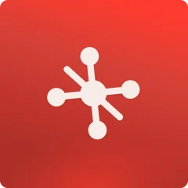
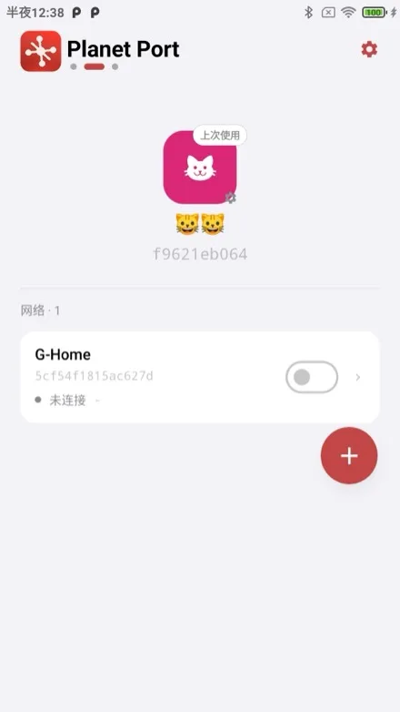
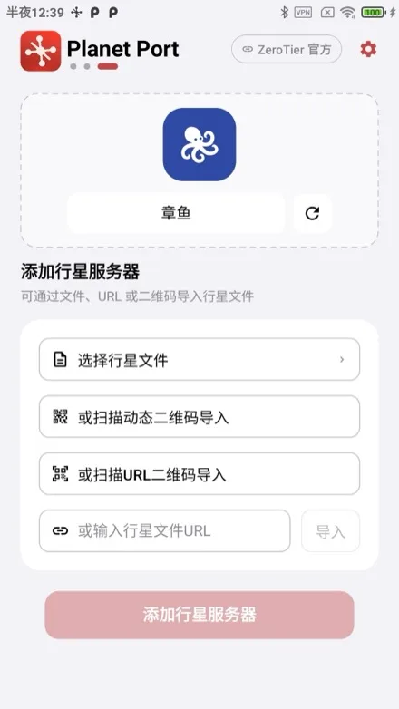
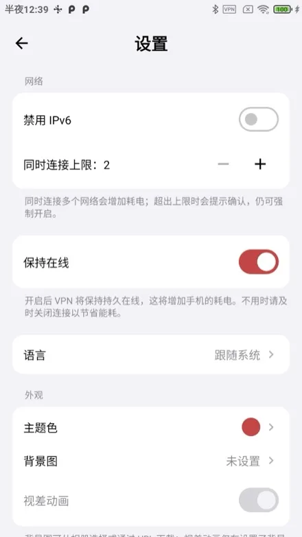
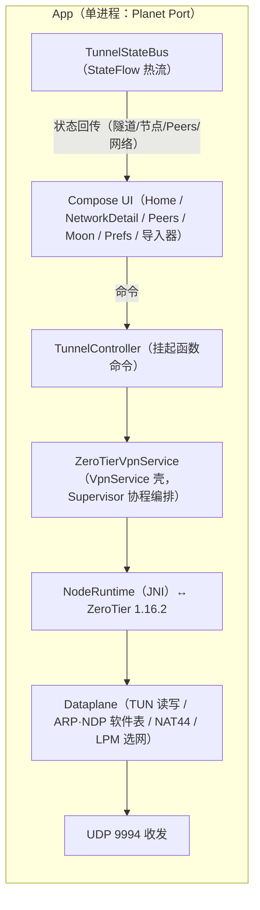

<p align="center">
  
</p>

# Planet Port 🪐

简体中文 | [繁體中文](README.zh-Hant.md) | [English](README.en.md)

**Planet Port** 是一款开源的 Android ZeroTier 客户端，基于 ZeroTier 1.16 官方核心打造。它让你在手机上轻松完成异地组网与虚拟局域网管理：多 Planet 并存（官方 + 自建私有 Planet），多网络同时连接，默认路由与 DNS 全自由掌控。原生 Jetpack Compose 实现，免费开源，是官方 ZeroTier One App 之外的进阶之选。

> 非官方客户端，与 ZeroTier, Inc. 无隶属关系。

## 特色

- **多 Planet 管理**：官方与多份私有 Planet 并存。可通过文件/URL、二维码方式导入
- **多网络同时连接**：软上限（默认 2，可调 2–6）带确认放行；地址/网段冲突自动检测并断开
- **完整网络管理**：加入/退出网络，实时状态提示，managed IP 一键复制
- **默认路由与 DNS 三模式**：经 ZT 路由开关、DNS 网络下发/自定义/不使用，全部隧道内热重配，无需重连
- **Moon 节点**：.moon 文件导入、手动 orbit、缓存管理
- **保持在线**：网络变化自动恢复连接；允许移动数据、禁用 IPv6 细粒度控制
- **主题定制**：预设国画经典色板 + 自定义拾色器，主色派生全局视觉（含行星装饰盘与状态色）
- **原生 Jetpack Compose**，界面简中/繁中/英文三语切换，无任何遥测

## 截图

<p align="center">
  
  
  
</p>


## 快速开始

> **系统要求**：Android 6.0（API 23）及以上。构建需 JDK 21 与 NDK 25.2.9519653（均可在 Android Studio 中安装）。

```bash
./scripts/bootstrap.sh
./gradlew assembleDebug
adb install app/build/outputs/apk/debug/app-debug.apk
```

`bootstrap.sh` 会按固定 tag（含 SHA256 校验）从 ZeroTier 官方仓库拉取核心源码到 `externals/core/`（已 gitignore，不入库），缓存于 `~/Library/Caches/PlanetPort/`，重跑秒过。下载失败时：

```bash
# 换镜像
ZT_TARBALL_URL=<镜像地址> ./scripts/bootstrap.sh
# 或浏览器手动下载 tarball 放到缓存目录后重跑（校验通过即离线使用）
mkdir -p ~/Library/Caches/PlanetPort
cp ZeroTierOne-1.16.2.tar.gz ~/Library/Caches/PlanetPort/
```

升级 ZeroTier 版本：修改 `scripts/bootstrap.sh` 中的 `ZT_VERSION` 与 `ZT_SHA256` 后重跑。

## 核心用法

1. **安装**：见「快速开始」构建 APK 安装；或 Android Studio 打开工程直接 Run。无签名门槛。
2. **加入网络**：首页添加行星（或使用官方 Planet）→ 输入 16 位网络 ID → 到 [ZeroTier Central](https://my.zerotier.com) 授权新节点 → 状态变「在线」即互通。
3. **切换 Planet**：导入私有 Planet 文件/URL → 首页左右翻页切换行星 → 打开其下网络开关即切换隧道。
4. **保持在线**：设置页开启「保持在线」，网络变化自动恢复连接。

## 架构



- **核心**：ZeroTier 1.16.2 以 JNI 形式跑在 App 进程内（无独立隧道进程），核心状态按当前 Planet 分目录落盘
- **通信**：UI 经 TunnelController 挂起函数下发命令，服务内各组件经 TunnelStateBus（StateFlow 热流）回传状态；**无 Binder、无 AIDL、无事件总线**
- **多网络数据面**：单 TUN 承载多网络，Dataplane 按网络隔离 MAC/地址/ARP/NDP 路由，IPv4 NAT 在数据面改写多网源地址，LPM 选网并检测网段冲突
- **帧语义**：C API 帧不含以太网头（MAC/etherType 为独立参数），Dataplane 负责与 TUN 的 L3 IP 包互转，ARP/NDP 为纯软件表

### 目录

- `externals/core/` — ZeroTier 1.16.2 核心源码（构建前由 `scripts/bootstrap.sh` 按官方 tag 拉取，不入库）
- `externals/CMakeLists.txt` — NDK 构建脚本（树外维护的 GLOB 构建胶水）
- `core/jni/` — JNI 绑定层（C API ↔ Kotlin）
- `app/` — 主 App（`ui/` Compose 界面、`tunnel/` 隧道与数据面、`store/` 配置存储）

## 致谢

- [ZeroTier](https://github.com/zerotier/ZeroTierOne) — 网络核心
- 部分动物图标来自 [Material Design Icons](https://pictogrammers.com/)（Pictogrammers Free License）与 [Font Awesome Free](https://fontawesome.com/)（CC BY 4.0，Icons by Font Awesome）。

## 捐赠

如果 Planet Port 帮到了你，欢迎请作者喝杯咖啡 ☕

**BTC**（Taproot）

```
bc1p5426677uuazuvfy9fptmczv4zwv550qlu9umw9jyptw5q7ln420qe03ae6
```

**ETH**（Ethereum）

```
0xbaa7a263a95bddb2ff364d1c47e385ed9f54a66a
```

**SOL**（Solana）

```
CFjZhq1dYdQCFKgkhbBwQEzg21WKwoNAm9KZ9uk2nJyf
```
