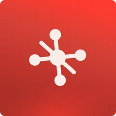
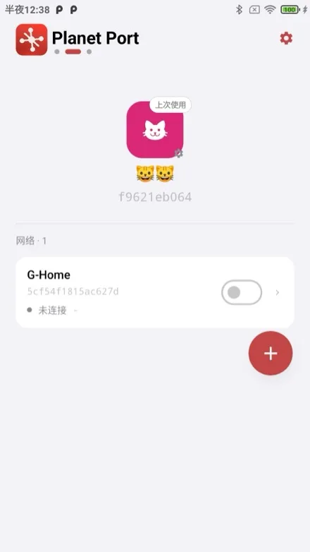
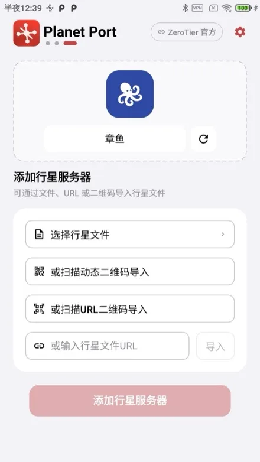
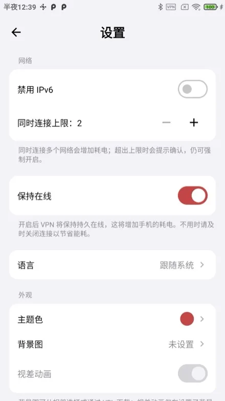
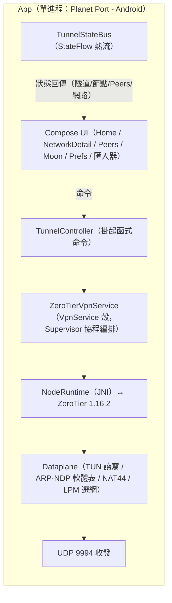

<p align="center">
  
</p>

# Planet Port - Android 🪐

[簡體中文](README.md) | 繁體中文 | [English](README.en.md)

**Planet Port - Android** 是一款開源的 Android ZeroTier 客戶端，基於 ZeroTier 1.16 官方核心打造。它讓你在手機上輕鬆完成異地組網與虛擬區域網路管理：多 Planet 並存（官方 + 自建私有 Planet），多網路同時連線，預設路由與 DNS 全自由掌控。原生 Jetpack Compose 實現，免費開源，是官方 ZeroTier One App 之外的進階之選。

> 非官方客戶端，與 ZeroTier, Inc. 無隸屬關係。

## 特色

- **多 Planet 管理**：官方與多份私有 Planet 並存。可透過檔案/URL、二維碼方式匯入
- **多網路同時連線**：軟上限（預設 2，可調 2–6）帶確認放行；位址/網段衝突自動偵測並斷開
- **完整網路管理**：加入/退出網路，即時狀態提示，managed IP 一鍵複製
- **預設路由與 DNS 三模式**：經 ZT 路由開關、DNS 網路下發/自訂/不使用，全部隧道內熱重配，無需重連
- **Moon 節點**：.moon 檔案匯入、手動 orbit、快取管理
- **保持線上**：網路變化自動恢復連線；允許行動數據、停用 IPv6 細粒度控制
- **主題定制**：預設國畫經典色板 + 自訂拾色器，主色衍生全域視覺（含行星裝飾盤與狀態色）
- **原生 Jetpack Compose**，介面簡中/繁中/英文三語切換，無任何遙測

## 截圖

<p align="center">
  
  
  
</p>

## 快速開始

> **系統要求**：Android 6.0（API 23）及以上。建置需 JDK 21 與 NDK 25.2.9519653（均可在 Android Studio 中安裝）。

```bash
./scripts/bootstrap.sh
./gradlew assembleDebug
adb install app/build/outputs/apk/debug/app-debug.apk
```

`bootstrap.sh` 會按固定 tag（含 SHA256 校驗）從 ZeroTier 官方倉庫拉取核心原始碼到 `externals/core/`（已 gitignore，不入庫），快取於 `~/Library/Caches/PlanetPort/`，重跑秒過。下載失敗時：

```bash
# 換鏡像
ZT_TARBALL_URL=<鏡像位址> ./scripts/bootstrap.sh
# 或瀏覽器手動下載 tarball 放到快取目錄後重跑（校驗通過即離線使用）
mkdir -p ~/Library/Caches/PlanetPort
cp ZeroTierOne-1.16.2.tar.gz ~/Library/Caches/PlanetPort/
```

升級 ZeroTier 版本：修改 `scripts/bootstrap.sh` 中的 `ZT_VERSION` 與 `ZT_SHA256` 後重跑。

## 核心用法

1. **安裝**：見「快速開始」建置 APK 安裝；或 Android Studio 開啟工程直接 Run。無簽名門檻。
2. **加入網路**：首頁新增行星（或使用官方 Planet）→ 輸入 16 位網路 ID → 到 [ZeroTier Central](https://my.zerotier.com) 授權新節點 → 狀態變「線上」即互通。
3. **切換 Planet**：匯入私有 Planet 檔案/URL → 首頁左右翻頁切換行星 → 開啟其下網路開關即切換隧道。
4. **保持線上**：設定頁開啟「保持線上」，網路變化自動恢復連線。

## 架構



- **核心**：ZeroTier 1.16.2 以 JNI 形式跑在 App 進程內（無獨立隧道進程），核心狀態按當前 Planet 分目錄落盤
- **通訊**：UI 經 TunnelController 掛起函式下發命令，服務內各元件經 TunnelStateBus（StateFlow 熱流）回傳狀態；**無 Binder、無 AIDL、無事件匯流排**
- **多網路資料面**：單 TUN 承載多網路，Dataplane 按網路隔離 MAC/位址/ARP/NDP 路由，IPv4 NAT 在資料面改寫多網來源位址，LPM 選網並偵測網段衝突
- **幀語義**：C API 幀不含乙太網路頭（MAC/etherType 為獨立參數），Dataplane 負責與 TUN 的 L3 IP 封包互轉，ARP/NDP 為純軟體表

### 目錄

- `externals/core/` — ZeroTier 1.16.2 核心原始碼（建置前由 `scripts/bootstrap.sh` 按官方 tag 拉取，不入庫）
- `externals/CMakeLists.txt` — NDK 建置腳本（樹外維護的 GLOB 建置膠水）
- `core/jni/` — JNI 綁定層（C API ↔ Kotlin）
- `app/` — 主 App（`ui/` Compose 介面、`tunnel/` 隧道與資料面、`store/` 配置儲存）

## 致謝

- [ZeroTier](https://github.com/zerotier/ZeroTierOne) — 網路核心
- 部分動物圖示來自 [Material Design Icons](https://pictogrammers.com/)（Pictogrammers Free License）與 [Font Awesome Free](https://fontawesome.com/)（CC BY 4.0，Icons by Font Awesome）。

## 捐贈

如果 Planet Port - Android 幫到了你，歡迎請作者喝杯咖啡 ☕

**BTC**（Taproot）

```
bc1p5426677uuazuvfy9fptmczv4zwv550qlu9umw9jyptw5q7ln420qe03ae6
```

**ETH**（Ethereum）

```
0xbaa7a263a95bddb2ff364d1c47e385ed9f54a66a
```

**SOL**（Solana）

```
CFjZhq1dYdQCFKgkhbBwQEzg21WKwoNAm9KZ9uk2nJyf
```
