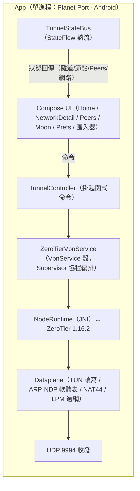

<p align="center">
  
</p>

# Planet Port - Android 🪐

[简体中文](README.md) | 繁體中文 | [English](README.en.md)

**Planet Port - Android** 是一款開源的 Android ZeroTier 用戶端，基於 ZeroTier 1.16.2 官方核心構建，以原生 Jetpack Compose 寫成。它在手機上管理行星（Planet）與網路：多顆行星並存，多個網路同時連線，預設路由與 DNS 均可控。

行星的匯入支援檔案、URL、QR Code，分享支援檔案、QR Code；官方 Planet 與自建私有 Planet 在同一首頁左右翻頁，通道隨切換即時生效。

免費開源，無任何遙測，官方 ZeroTier One App 之外的進階之選。

> 非官方用戶端，與 ZeroTier, Inc. 無隸屬關係。

## 緣起

用 ZeroTier 搭自己的私有網路快三年了。最深的感觸是「一次設定，無感使用」——它不打擾，卻又無所不在，到哪都能直連家裡的裝置。

Android 端雖有 ZerotierFix 可以自訂 Planet，但在行星的匯入與分享、多網路同連、路由與 DNS 的細節控制上，始終差一口氣。於是把 iOS 版 Planet Port 的整套體驗帶到了 Android，就是現在的 Planet Port - Android。

## 功能

### 行星（Planet）管理

- **多行星並存**：官方 Planet 與多份私有 Planet 一同管理，通道同一時刻只套用一套
- **匯入**：行星檔案、檔案 URL、QR Code。QR Code 為動態分片傳輸，容量自適應，大檔案也傳得動；掃碼支援相機即時掃描與相簿圖片辨識
- **分享**：檔案（拉起系統分享面板）、QR Code，裝置間互傳只需幾秒
- **行星即世界**：核心狀態按行星分目錄落盤，切換行星不串資料
- **跨行星切換**：先確認斷開、再啟動新通道，彈窗確認流程，過程可控
- **查重保護**：按 World ID 去重，同一顆行星無法重複加入
- **Moon 節點**：.moon 檔案匯入、手動 orbit、快取管理
- **節點身份模式**：所有行星共用一個節點身份，或每個行星使用獨立身份（互不可關聯）；可隨時切換，各行星身份保留、切回即恢復

### 網路連線

- **多網路同連**：單一通道承載多個網路，軟上限預設 2 條，可在 2–6 之間調整；超出上限需確認放行
- **衝突自動斷開**：位址或網段衝突自動偵測並斷開，網路卡片直接顯示衝突原因
- **開關即連線**：網路行的開關直接套用通道設定，狀態即時可見
- **狀態細化**：正在初始化 → 連線伺服器 → 線上，每個階段都有明確文案；連線伺服器逾時自動重啟核心無感重試（不限次數，直到上線或手動關閉），斷網即時提示「無網路」，網路切換自動重連
- **加入網路**：輸入 16 位網路 ID 或掃碼加入，到 [ZeroTier Central](https://my.zerotier.com) 授權新節點後即互通
- **一鍵複製**：managed IP、節點 ID、網路 ID 點擊即複製，網路 ID 另支援 QR Code

### 路由與 DNS

- **預設路由**：「經 ZeroTier 路由」一鍵開關，全部流量走通道
- **DNS 三模式**：使用網路下發 / 自訂 / 不使用
- **熱重配**：路由與 DNS 的全部調整都在通道內完成，不用斷開重連
- **IPv6**：可按需停用

### Peers

- **Peers 即時列表**：延遲按語義色呈現（<30ms 綠 / <100ms 橙 / ≥100ms 紅），無直連路徑時標註「中轉 relay」

### 體驗

- **保持連線**：開啟後網路變化（Wi-Fi 與行動網路切換）自動恢復連線
- **主題自訂**：預設國畫經典色板 + HSL 色盤自選主色，行星裝飾盤與狀態色由主色全域衍生
- **背景視差**：自訂背景圖（相簿或 URL），重力感測器驅動的背景視差動畫。可關閉
- **多語言支援**：目前支援簡體中文、繁體中文、English
- **資料面診斷**：出/入站流量、ARP 問答、無路由丟棄計數與事件日誌，便於定位問題
- **無遙測**：不收集任何資料


## 上手使用

1. **加入網路**：首頁新增或選擇一顆行星（官方 Planet 開箱即用）→「新增網路」輸入 16 位網路 ID，或掃碼加入 → 到 ZeroTier Central 授權新節點 → 狀態變「線上」即互通。
2. **切換行星**：匯入私有 Planet（檔案 / URL / QR Code）→ 首頁左右翻頁 → 開啟該行星下的網路開關，通道隨即切換到新行星。
3. **保持連線**：設定頁開啟「保持連線」，網路變化自動恢復連線。

## 截圖

<p align="center">
  
  
  
</p>

## 從原始碼建置

> **系統需求**：Android 6.0（API 23）及以上。建置需 JDK 21 與 NDK 25.2.9519653（均可在 Android Studio 中安裝）。

```bash
./scripts/bootstrap.sh
./gradlew assembleDebug
adb install app/build/outputs/apk/debug/app-debug.apk
```

也可用 Android Studio 開啟工程直接 Run。無簽名門檻。

`bootstrap.sh` 負責拉取 ZeroTier 核心原始碼並產生建置工程：核心原始碼按固定 tag 下載（含 SHA256 校驗）到 `externals/core/`（已 gitignore，不入庫），並快取於 `~/Library/Caches/PlanetPort/`，重跑秒過。

下載失敗時有兩個辦法：

```bash
# 改用鏡像
ZT_TARBALL_URL=<鏡像位址> ./scripts/bootstrap.sh

# 或把 tarball 放進快取目錄後重跑（校驗通過即可離線使用）
mkdir -p ~/Library/Caches/PlanetPort
cp ZeroTierOne-1.16.2.tar.gz ~/Library/Caches/PlanetPort/
```

升級 ZeroTier 版本：修改 `scripts/bootstrap.sh` 中的 `ZT_VERSION` 與 `ZT_SHA256` 後重跑。

## 架構



- **行程模型**：ZeroTier 1.16.2 以 JNI 形式跑在 App 行程內（無獨立通道行程），核心狀態按當前行星分目錄落盤
- **通訊**：UI 經 TunnelController 掛起函式下發命令，服務內各元件經 TunnelStateBus（StateFlow 熱流）回傳狀態；**無 Binder、無 AIDL、無事件匯流排**
- **多網路資料面**：單一 TUN 承載多網路，Dataplane 按網路隔離 MAC / 位址 / ARP / NDP / 路由；多網路來源位址由 NAT44 在資料面改寫收發位址修復；LPM 選網並偵測網段衝突
- **幀語義**：C API 幀不含乙太網路頭（MAC 與 etherType 是獨立參數），Dataplane 負責與 TUN 的三層 IP 封包互轉，ARP / NDP 為純軟體表

### 目錄

- `externals/core/` — ZeroTier 1.16.2 核心原始碼（建置前由 `scripts/bootstrap.sh` 按官方 tag 拉取，不入庫）
- `externals/CMakeLists.txt` — NDK 建置腳本（樹外維護的 GLOB 建置膠水）
- `core/jni/` — JNI 綁定層（C API ↔ Kotlin）
- `app/` — 主 App（`ui/` Compose 介面、`tunnel/` 通道與資料面、`store/` 設定儲存）

### 延伸閱讀

- [CHANGELOG.md](CHANGELOG.md) — 版本變更記錄

## 致謝與授權

- [ZeroTier](https://github.com/zerotier/ZeroTierOne) — 網路核心，MPL-2.0，授權條款全文見 [docs/licenses/ZeroTierOne-MPL-2.0.txt](docs/licenses/ZeroTierOne-MPL-2.0.txt)；隨核心分發的 nlohmann/json 與 prometheus-cpp-lite 為 MIT，見 `docs/licenses/`
- App 本體採用 [MIT](LICENSE) 授權條款
- 部分動物圖示來自 [Material Design Icons](https://pictogrammers.com/)（Pictogrammers Free License）、[Font Awesome Free](https://fontawesome.com/)（CC BY 4.0，Icons by Font Awesome）與 [game-icons](https://game-icons.info/)（Lorc、Delapouite 等作者，CC BY 3.0）；上述圖示素材均經重新著色與格式轉換

## 捐贈

如果 Planet Port - Android 幫到了你，歡迎請作者喝杯咖啡 ☕

**BTC**（Taproot）

```
bc1p5426677uuazuvfy9fptmczv4zwv550qlu9umw9jyptw5q7ln420qe03ae6
```

**ETH**（Ethereum）

```
0xbaa7a263a95bddb2ff364d1c47e385ed9f54a66a
```

**SOL**（Solana）

```
CFjZhq1dYdQCFKgkhbBwQEzg21WKwoNAm9KZ9uk2nJyf
```
